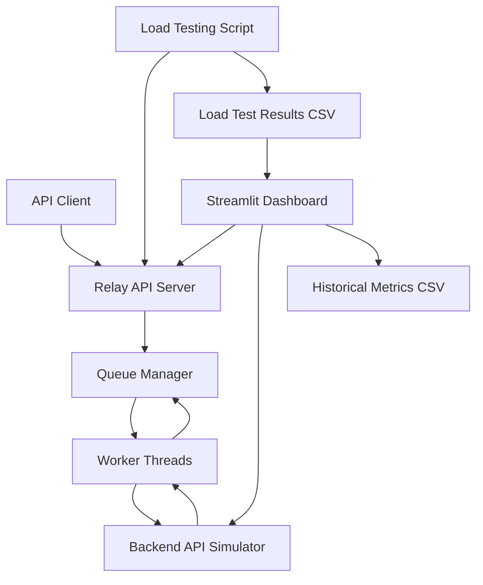
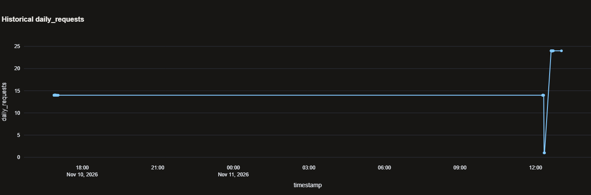
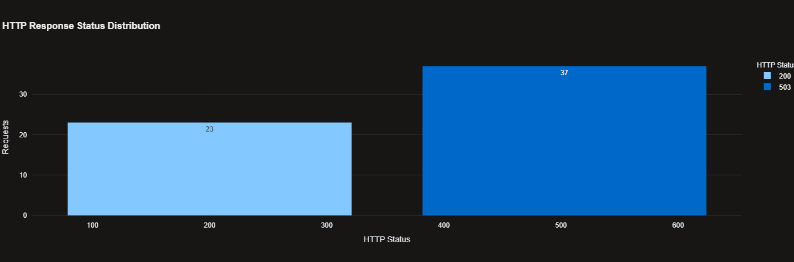
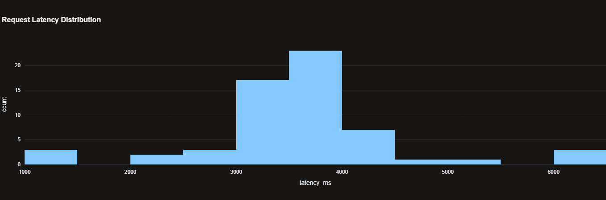
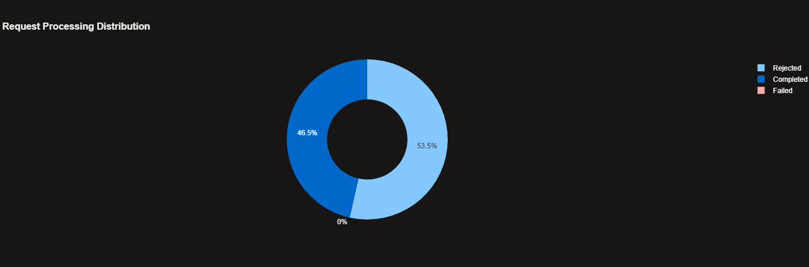

# ⚡ The Relay V2
## API Reliability & Monitoring Dashboard

The Relay is a Python-based API reliability and monitoring system designed to simulate API traffic, manage concurrent requests, handle queue overload, and monitor service performance through a real-time Streamlit dashboard.

It demonstrates how an API relay system can manage requests between clients and a backend service while providing visibility into latency, queue performance, rate limits, and HTTP errors.

## 🚀 Key Features

- **API Relay Server:** Accepts client requests and forwards them to the backend simulator.
- **Request Queue Management:** Uses a worker-based queue to process concurrent requests.
- **Concurrency Management:** Supports multiple workers and configurable queue capacity.
- **Overload Handling:** Rejects requests when the queue reaches capacity.
- **Retry Tracking:** Records retry attempts and request outcomes in load-test results.
- **API Rate Limiting:** Simulates request and token usage limits.
- **Performance Monitoring:** Tracks request latency, processing time, and queue wait time.
- **Streamlit Dashboard:** Displays live service health and performance metrics.
- **Historical Monitoring:** Stores dashboard metrics in CSV format.
- **Load Testing:** Tests concurrent requests and analyses HTTP responses.

## 🏗️ System Architecture



## 🛠️ Technologies Used

- Python
- Streamlit
- Requests
- Pandas
- NumPy
- Plotly
- Threading
- Concurrent Futures
- CSV

## 📁 Project Structure

```text
The_Relay/
│
├── dashboard.py
├── requirements.txt
├── dashboard_metrics_history.csv
├── relay_retry_load_results.csv
│
├── src/
│   ├── simulator.py
│   ├── relay_server.py
│   ├── queue_manager.py
│   └── load_test.py
│
├── data/
├── results/
│
└── README.md
```

## ⚙️ Installation and Setup

### 1. Clone the repository

```bash
git clone YOUR_GITHUB_REPOSITORY_URL
cd The_Relay
```

### 2. Create a virtual environment

```bash
python -m venv venv
```

### 3. Activate the environment (Windows)

```powershell
.\venv\Scripts\Activate.ps1
```

### 4. Install dependencies

```bash
pip install -r requirements.txt
```

## ▶️ Running the Project

Start each service in a separate terminal.

**Terminal 1 — Backend Simulator**

```bash
python src/simulator.py
```

**Terminal 2 — Relay API Server**

```bash
python src/relay_server.py
```

**Terminal 3 — Streamlit Dashboard**

```bash
streamlit run dashboard.py
```

Open the dashboard:

```text
http://localhost:8501
```

## 🔌 API Endpoints

| Endpoint | Method | Description |
|---|---|---|
| `/health` | GET | Service health check |
| `/metrics` | GET | Service metrics |
| `/v1/chat/completions` | POST | Chat completion request |

Default local service addresses:

- Simulator: `http://127.0.0.1:8000`
- Relay API: `http://127.0.0.1:8001`
- Dashboard: `http://localhost:8501`

## 🧪 Load Testing

The project includes a concurrent load-testing script.

Run:

```bash
python src/load_test.py
```

Test configuration:

| Parameter | Value |
|---|---:|
| Total requests | 60 |
| Concurrent users | 30 |
| Maximum retries | 2 |
| Retry strategy | Exponential backoff |

### Observed Load-Test Results

| Metric | Result |
|---|---:|
| Total requests | 60 |
| Successful requests | 23 |
| Failed requests | 37 |
| Success rate | 38.33% |
| Average latency | 3,477.15 ms |
| P50 latency | 3,559.14 ms |
| P95 latency | 5,226.32 ms |

**Observation:** The test exposed queue saturation under 30 concurrent users. The Relay returned HTTP 503 responses when its available queue capacity was exceeded.

These are results from one test run, not guaranteed performance benchmarks.

## 📊 Monitoring Dashboard

The Streamlit dashboard provides:

1. Service health monitoring
2. API usage and rate-limit monitoring
3. Queue and worker performance
4. Request latency analytics
5. HTTP response status distribution
6. Historical performance tracking

It automatically refreshes live metrics every five seconds.

## 🎯 Project Objectives

- Understand API request handling and forwarding.
- Implement concurrent request processing.
- Explore queue management and overload protection.
- Monitor API performance and service health.
- Analyse latency and HTTP error distributions.
- Evaluate system behaviour under concurrent workloads.
## 📊 Dashboard Preview

### Historical Performance


### HTTP Response Status


### Request Latency Distribution


### Request Processing Distribution



## 🔮 Future Improvements

- Persistent database integration.
- Advanced retry and circuit-breaker strategies.
- Authentication and API key management.
- More extensive stress testing.
- Deployment using Docker.
- Improved observability and alerting.

## 👨‍💻 Author

**Aman Kaushik**

B.Tech – Information Technology

Interested in Python, Backend Development, Data Analytics, and System Reliability.

---

*The Relay V2 — API Reliability & Monitoring Dashboard*